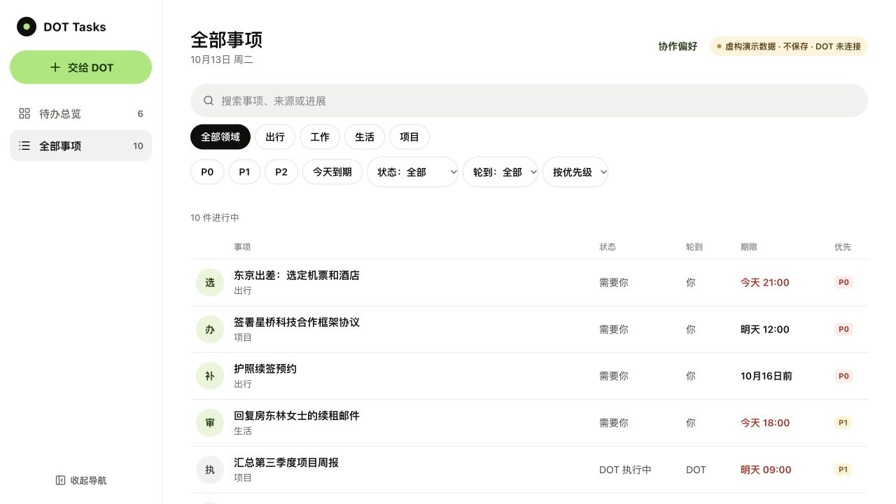

# DOT Tasks

**Organize your to-dos. Keep things moving with your own DOT.**

[中文说明](README.zh-CN.md) · [Connect your DOT](docs/CONNECT-DOT.md) · [How autonomy works](docs/AUTONOMY.md)



DOT Tasks gives your DOT a persistent task list you can see and edit on your phone or desktop.

- **Organize:** turn actual requests into tasks, match existing items, and assign P0 / P1 / P2 with a reason.
- **Advance:** let your connected DOT choose ready tasks, research, prepare drafts and report progress. Work that needs you comes back with a concrete question or action.
- **Stay in control:** pause a task, change priority, review a draft or ask for a revision. A changed draft needs a new approval.

The app stores and displays work. Your DOT provides reasoning and execution. Background progress needs a connected DOT and a verified cloud schedule; starting the web app alone does not start an agent.

## Try it locally

Install **Node.js 22.13+**. Download the repository ZIP and open a terminal inside the extracted folder:

```sh
npm run setup
npm run dev
```

Open the printed `http://localhost:5173/?demo=1` URL. The demo uses fictional, temporary data; refresh resets it. Nothing is sent and no account or schedule is connected.

If you prefer Git, clone this repository and enter its folder before those two commands.

`setup` installs locked dependencies, builds the Worker and applies **local** database migrations. It preserves existing task data and remembers the selected mode. It does not publish a Site, authenticate external accounts or create scheduled work.

### Empty, persistent local data

```sh
npm run setup -- --empty
npm run dev
```

Open the printed local sign-in URL. This uses a development-only simulated identity on loopback, not your real ChatGPT account. Data stays in this checkout's ignored `.wrangler/` directory.

Return to the demo with `npm run setup -- --demo`. This changes the opening instructions, not the persistent database. Another port: `npm run dev -- --port 5174`.

## Use it with your own DOT

The first release targets **one private deployment per person** on ChatGPT Sites. Each deployment gets its own database and Site plugin. Feature availability depends on your ChatGPT account/workspace.

1. Open this repo in Codex, or attach it to ChatGPT Work with Sites available.
2. Paste [SETUP.md](SETUP.md). The agent creates a new private Site, deploys it and checks its generated MCP plugin.
3. Complete your own connection prompts, then run the synthetic test in [Connect DOT](docs/CONNECT-DOT.md). Enable background checking only after choosing a schedule and verifying an actual run.

This is guided setup, not an already-verified one-click installer across accounts. Local installation is tested separately from someone else's account, plugin and scheduler setup.

## Priority and progress

| Priority | Meaning |
| --- | --- |
| P0 | Urgent or high-impact work needing attention first, supported by actual context |
| P1 | Important work with a concrete next step |
| P2 | Flexible or lower-impact work that can wait |
| Unassigned | More context is needed; DOT should not invent a deadline |

DOT assesses priorities; the queue orders eligible work using priority, handoffs, deadlines and time since the last check. Paused tasks, completed work, active claims, unresolved dependencies and future checks are excluded. See the [agent contract](lib/agent-contract.ts).

## Development

```sh
npm test
npm run test:setup
npm run typecheck
npm run check:release
npm run build
```

The release check requires Git and is for the clean public template. A provisioned private installation has its own Site ID and intentionally fails that template check.

- `components/workbench/`: responsive UI and state model. Internal filenames retain their original names.
- `app/api/state/`: authenticated state writes with revision conflict protection.
- `app/mcp/`: Site-hosted tools for DOT.
- `lib/intelligence.ts`: eligible queue, claims, dependencies and changes.
- `lib/agent-contract.ts`: priority, autonomy and approval instructions returned to DOT.
- `drizzle/`: database migrations.

## Deployment boundaries

This release uses Vinext, Cloudflare D1 and Sites-managed identity. It is not a drop-in Vercel deployment or a standalone DOT runtime. Source routes rely on Sites-injected identity headers; do not expose them on an untrusted origin or accept client identity headers as authentication.

Each instance has one shared `owner` workspace. Keep it owner-private. Sharing an instance would share its records; multi-user isolation is not implemented.

The development command enables the explicit fictional-data URL. Production builds default to live data. Keep local runtime directories, sessions, credentials and task exports out of releases.

## License

MIT for original project code. Vendored OpenAI and shadcn code retain their MIT notices; see [THIRD-PARTY-NOTICES.md](THIRD-PARTY-NOTICES.md). This is an independent project, not an official OpenAI product.
