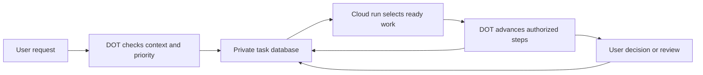

# Organize, then advance

1. **DOT understands requests:** task versus discussion, matching existing items, source-backed priority and a concrete next step.
2. **The app coordinates:** persist tasks, protect concurrent writes and return eligible work. The connected DOT/cloud executor performs authorized steps and records actual results.



## Priorities

Read `agentContract.prioritization` each run. P0 needs urgency/high impact supported by context; P1 is important normal work; P2 can wait. Unknown priority remains null. User edits take precedence. Store the reason in `plan.why`.

`plan_pull` considers priorities, new handoffs, deadlines and time since the last check. It excludes paused/closed work, unresolved dependencies, active claims and future checks. A shared source failure is checked once; unrelated work continues. The queue does not run a model, create a schedule or grant permission.

## Cloud-pull instruction

Use after connecting the private Site plugin. The owner chooses and verifies the schedule.

```text
Read read_workbench, list_inbox and the latest agentContract first. Reconcile
new commands with existing tasks. Preserve user edits and paused/completed
state. Organize actual to-dos into P0/P1/P2 with reasons; do not invent fields.

Call plan_pull. Advance within its maxTasks, maxStepsPerTask and maxMinutes.
Claim the current handoff and use the returned lease before writing. Re-read
between tasks. If a source, user decision or local device blocks one step,
continue other ready work. Use only actually available, authorized tools.

For revision feedback, read the latest request, change the body, update
preparation and briefing while the lease is valid, create a fresh review,
release the lease and read back. New content needs a new exact approval.

Record genuine progress, source checks and receipts. Distinguish pending,
prepared, executed and verified results. Follow notification deduplication
rules; stay quiet when nothing useful changed. Never resume paused schedules
or execute external actions without authority.
```

## Evidence and architecture

A schedule setting is not a run; a run is not task completion. A stored notification is not delivery; approval is not a send receipt. Verify each through the actual source. Only an actual schedule receipt can make a monitor active. The refresh button reads state only.

D1 holds JSON state with a revision counter. `GET/PUT /api/state` serves the UI; `POST /mcp` exposes tools through the Site's generated plugin. Identity comes from trusted Sites dispatch. There is one workspace per private instance.

No model API key, local daemon, notification transport or external credentials are bundled. Connect needed tools in your own account.
